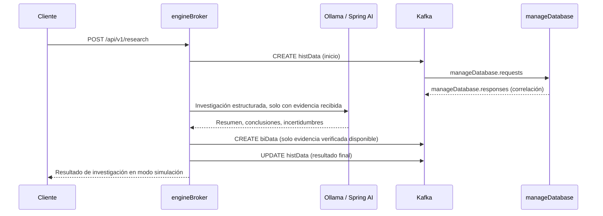

# engineBroker

Beta local de investigación de instrumentos para Automatic Broker. El servicio
solo ofrece investigación asistida y simulación: no conecta con brokers, no
envía órdenes y no implementa reglas de riesgo.

## Flujo



La entrada es REST; las dos operaciones Kafka son solicitudes síncronas
correlacionadas según los envelopes de `manageDatabase`. No hay acceso MongoDB
desde este servicio.

## Requisitos y ejecución local

- Java 25 (LTS) y Maven (o el Maven Wrapper del proyecto).
- Kafka y MongoDB disponibles para `manageDatabase`, usando la infraestructura y
  configuración local existentes en ese microservicio. `engineBroker` no crea
  brokers, bases de datos ni topics.
- Ollama local y el modelo configurado:

```powershell
ollama serve
ollama pull llama3.2:3b
```

El perfil `local` usa `localhost:9092`, `http://localhost:11434` y el modelo
`llama3.2:3b`. Se pueden sustituir por variables de entorno:

| Variable | Predeterminado |
|---|---|
| `KAFKA_BOOTSTRAP_SERVERS` | `localhost:9092` |
| `KAFKA_CONSUMER_GROUP` | `engineBroker-local` |
| `MANAGEDATABASE_REQUEST_TOPIC` | `manageDatabase.requests` |
| `MANAGEDATABASE_RESPONSE_TOPIC` | `manageDatabase.responses` |
| `MANAGEDATABASE_SEND_TIMEOUT` | `5s` |
| `MANAGEDATABASE_RESPONSE_TIMEOUT` | `15s` |
| `OLLAMA_BASE_URL` | `http://localhost:11434` |
| `OLLAMA_MODEL` | `llama3.2:3b` |
| `OLLAMA_TEMPERATURE` | `0.2` |
| `AI_PROVIDER` | `ollama` |
| `AI_TIMEOUT` | `90s` |
| `APP_LOG_LEVEL` | `INFO` |

## Proveedor de IA

La integración se divide en estas responsabilidades:

- `InvestmentResearchServiceImpl` dirige la investigación, verifica y normaliza
  evidencia, gestiona errores y persistencia. Solo conoce la interfaz
  `ResearchAiProvider`.
- `ResearchPromptBuilder` carga el prompt existente
  (`prompts/instrument-research-system.md`) y construye el `ResearchAiRequest`
  común con el objetivo y la evidencia ya verificada.
- `ResearchAiProvider` recibe ese request y devuelve un `ResearchAiResponse`.
  Expone `providerName()` y `modelName()` para identificar el motor usado.
- `OllamaResearchAiProvider` implementa el contrato usando Spring AI. Es
  responsable de la llamada, el timeout y la conversión de la respuesta JSON al
  DTO común; no implementa reglas de investigación, normalización ni
  persistencia.

La selección se configura en `app.research.ai.provider` (variable de entorno
`AI_PROVIDER`) y el valor predeterminado es `ollama`. Por ejemplo, en PowerShell:

```powershell
$env:AI_PROVIDER = "ollama"
$env:OLLAMA_BASE_URL = "http://localhost:11434"
$env:OLLAMA_MODEL = "llama3.2:3b"
$env:OLLAMA_TEMPERATURE = "0.2"
$env:AI_TIMEOUT = "90s"
.\mvnw.cmd spring-boot:run
```

`AI_PROVIDER` y `AI_TIMEOUT` son ajustes comunes de la aplicación. `OLLAMA_BASE_URL`,
`OLLAMA_MODEL` y `OLLAMA_TEMPERATURE` configuran Spring AI/Ollama; el modelo no
es el proveedor. En `src/main/resources/application.yml` se encuentran los
valores predeterminados y sus propiedades de Spring AI. Si `AI_PROVIDER` no
coincide con un proveedor registrado, la aplicación falla al iniciar e indica
los proveedores disponibles; no hay fallback automático.

Para añadir un proveedor:

1. Implementa `ResearchAiProvider`: `research(ResearchAiRequest)` debe devolver
   `ResearchAiResponse`, y `providerName()` y `modelName()` deben devolver los
   identificadores usados para seleccionarlo y registrarlo.
2. Registra la implementación como bean con el qualifier
   `researchAiProviderImplementation`, y añade únicamente las dependencias y
   propiedades específicas que ese proveedor requiera. Reutiliza Spring AI si
   dispone de una integración adecuada.
3. Traduce timeout, indisponibilidad y fallos de comunicación a las excepciones
   específicas del paquete `util.exception`; usa `InvalidAiResponseException`
   para respuestas vacías o que no cumplan el formato estructurado.
4. Selecciónalo con `AI_PROVIDER=<providerName>`. El servicio de investigación,
   la normalización y los contratos Kafka no deben modificarse.

El proveedor y el modelo se registran en los logs de cada investigación; no se
registran credenciales. Las pruebas unitarias utilizan un proveedor mock o
Spring AI simulado, así que no requieren levantar Ollama, Kafka ni MongoDB:
`.\mvnw.cmd test`.

En Windows, desde la raíz:

```powershell
.\mvnw.cmd test
.\mvnw.cmd spring-boot:run
```

El perfil local enlaza el servidor HTTP a `127.0.0.1`. No expongas este API a
una red compartida: autenticación y autorización no forman parte de esta beta.

## Solicitud y respuesta

```powershell
$body = @{
  market = "EU"
  instrument = "SAP"
  objective = "Resume las hipótesis que puedan investigarse para este instrumento."
  simulation = $true
} | ConvertTo-Json

Invoke-RestMethod `
  -Method Post `
  -Uri http://localhost:8080/api/v1/research `
  -ContentType "application/json" `
  -Body $body
```

La respuesta contiene `executionId`, `status`, `summary`, `conclusions`
(clasificadas como `FACT`, `INFERENCE`, `HYPOTHESIS` o `PREDICTION`),
`evidence`, `uncertainties`, `simulation`, `historyPersisted`,
`dataPersisted` y `persistedDataCount`. `FACT` requiere referencias a fuentes
verificadas incluidas en la solicitud al modelo; las afirmaciones no verificadas
se descartan o se reflejan como incertidumbres.

## Integración Kafka y colecciones

- Requests: `manageDatabase.requests`; responses correlacionadas:
  `manageDatabase.responses`.
- Envelope enviado: `messageId`, `correlationId`, `operation`, `payload` y
  `responseRequired=true`. Se usan solo `CREATE` y `UPDATE`, implementados por
  `manageDatabase`. El request se envía como objeto `DatabaseRequestEnvelope`
  mediante `JsonSerializer`, por lo que Kafka contiene un objeto JSON directo,
  por ejemplo `{"messageId":"...","correlationId":"...","operation":"CREATE",
  "payload":{"collection":"histData","document":{...}},"responseRequired":true}`;
  no se serializa primero a `String` (lo que produciría un JSON escapado).
- La clave del request y el `correlationId` son iguales; la respuesta se recibe
  como texto JSON y se comprueba contra `requestId`, `correlationId` y operación.
- `histData`: un `CREATE` al inicio y un `UPDATE` al finalizar o registrar un
  error. El identificador se toma de la respuesta de `manageDatabase`; no se
  inventa ni se asume que el id lógico pertenece al servicio cliente.
- `biData`: solo se crean documentos provenientes de evidencia externa marcada
  como verificada y con procedencia completa. `manageDatabase` genera su id.
- `webData`, `opData` y `globalConfiguration` no se consultan: el dispatcher no
  admite `GET_MANY`, y no hay identificadores configurados para un `GET`
  individual. No se inventan payloads ni un segundo contrato para hacerlo.
- `manageDatabase` entrega al menos una vez; no hay idempotencia distribuida.
  Fallos después de una escritura parcial pueden dejar documentos persistidos y
  una repetición puede duplicarlos.

## Fuentes, límites y seguridad

Actualmente `NoExternalResearchSourceAdapter` no obtiene datos reales. Por ello
no se guarda nada en `biData`; la respuesta de Ollama debe expresar esa falta de
evidencia y sus conclusiones no se presentan como hechos. La interfaz
`ResearchSourceAdapter` permite añadir en el futuro conectores configurados y
con procedencia verificable. El contenido externo se trata como dato no
confiable, nunca como instrucciones para el modelo.

Las credenciales de Kafka, Ollama o servicios externos no se incluyen en el
prompt ni en logs. No se persisten prompts o respuestas completas de fuentes.
Las predicciones del modelo no son hechos ni instrucciones de inversión; no hay
órdenes, compras, ventas, gestión de riesgo, usuarios autenticados ni conexión
operativa con brokers. El transporte Kafka está configurado para la integración
local descrita; la configuración de producción y la seguridad del endpoint
requieren una decisión de despliegue separada.

## Pruebas y procedimiento E2E

```powershell
.\mvnw.cmd test
```

Las pruebas unitarias no requieren servicios externos. Para probar de extremo a
extremo, inicia Kafka y MongoDB con la infraestructura ya existente, ejecuta
`manageDatabase` en su perfil local, arranca Ollama con el modelo descargado y
ejecuta `engineBroker`. Después envía la solicitud PowerShell anterior. No se
necesita credencial de mercado y no se realizan operaciones financieras.

La beta no tiene conector de mercado, configuración de fuentes desde `webData`,
lectura de prompts desde `opData`, gestión de usuarios ni estadísticas.
